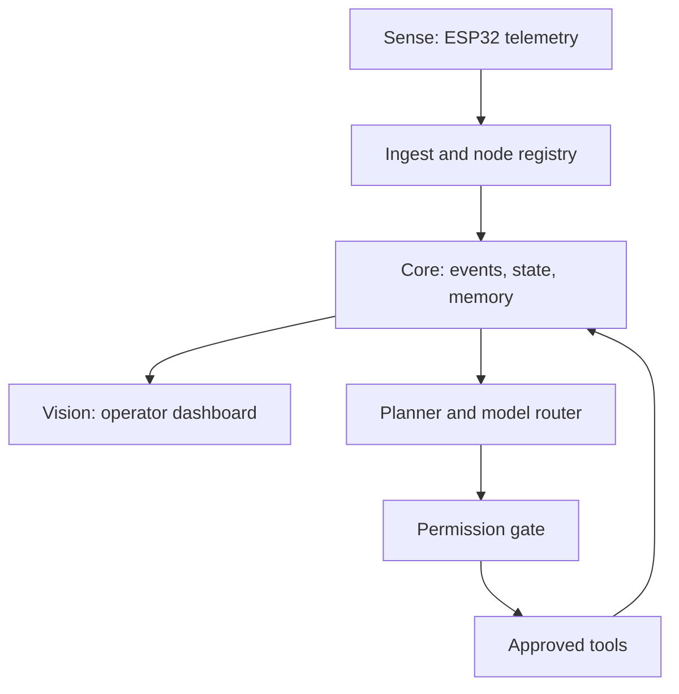
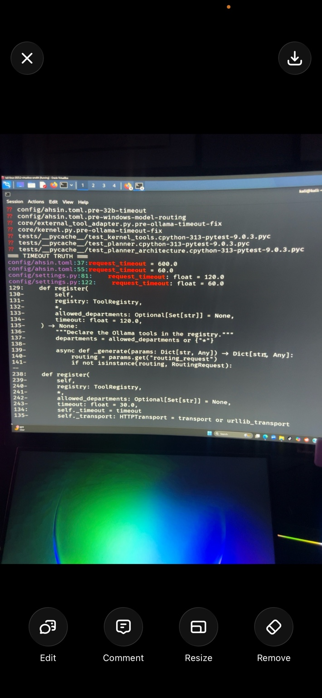
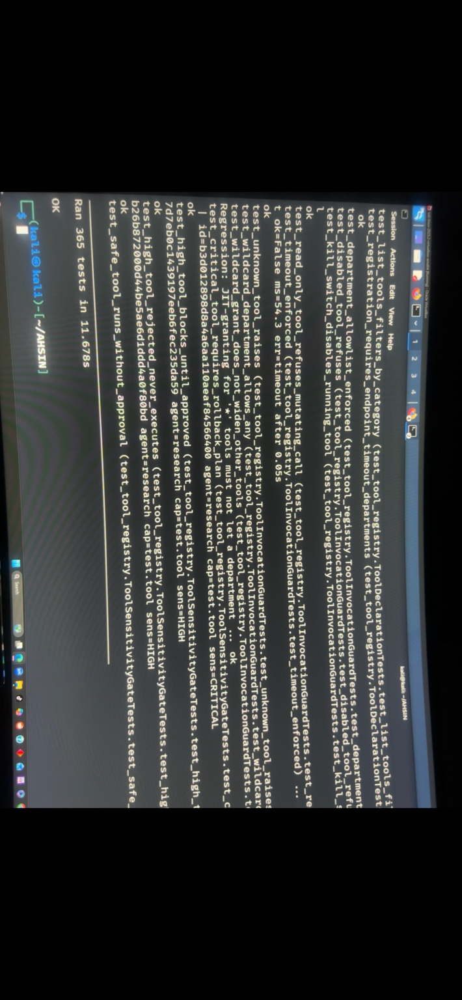

# AHSIN

**[Watch the three recorded AHSIN demos](https://github.com/mandozone/ahsin/releases/tag/media-2026-10-10)** — voice playback, executive console, and the earlier dashboard prototype. The gallery explains privacy edits and evidence limits.

## Ambient Human State Intelligence Network

**An independent lab project by Romando Wright exploring sensor telemetry, Linux infrastructure, and permission-controlled AI tools.**

AHSIN brings together work on ESP32 sensor nodes, telemetry collection, local dashboards, and a Python agent framework. The engineering focus is making each part observable: what a device sends, what a service receives, what a dashboard displays, and what an agent is permitted to do.

This public repository contains the project manual, architecture notes, troubleshooting records, and selected evidence. The application source, private deployment configuration, and raw sensor recordings are not included in this documentation release.

### Project at a glance

| Area | Work documented | Evidence status |
| --- | --- | --- |
| Linux and virtualization | Kali Linux development environment, container deployment, service and connectivity diagnostics | Historical screenshots and build notes |
| Sensor telemetry | ESP32 firmware experiments, UDP intake, MQTT integration, and node identification | Historical manual reports; repeatable multi-node validation is a next step |
| Agent framework | Event bus, state and memory components, task planning, tool registration, permission checks, and model routing | Development records and a historical test-run screenshot |
| Dashboard | RuView evaluation and a separate AHSIN interface prototype | Some views use simulated data; labels and counters alone do not establish live telemetry |
| Research | Multi-node fusion, room calibration, and ambient sensing | Experimental; no validated medical or through-wall accuracy claims |

### How the work fits together

This is the project's conceptual architecture. Individual components were developed at different stages; the diagram is not a claim that every connection is integrated and validated today.

### Engineering highlights

- Investigating timeouts across configuration, model adapters, and transport layers rather than changing one value blindly.
- Separating device boot, packet arrival, payload decoding, and dashboard freshness into distinct checks.
- Developing tool restrictions for read-only access, department scope, approval requirements, timeouts, and a kill switch.
- Keeping historical test results tied to their evidence instead of treating them as a current build badge.
- Documenting recovery steps, incomplete integrations, and the difference between simulated and hardware-generated data.

### Selected evidence

**Timeout investigation.** The terminal shows inspection of configuration and adapter code. This records a debugging step; it does not, by itself, prove that the timeout was resolved.

**Historical test run.** The photograph reports `Ran 365 tests` and `OK`. Visible cases cover tool access restrictions and execution controls. It is evidence of that captured run, not a test result produced from this public repository.

The selected photographs retain their original image pixels. Embedded metadata was removed; the test photograph's display orientation was corrected. See the [evidence register](docs/STATUS_AND_EVIDENCE.md) for limitations and provenance.

### Read the manual

| Guide | What it covers |
| --- | --- |
| [Architecture](docs/ARCHITECTURE.md) | Sense, Core, Vision, model routing, and trust boundaries |
| [Operator manual](docs/OPERATOR_MANUAL.md) | Baseline checks, startup order, telemetry checks, and shutdown |
| [Configuration reference](docs/CONFIGURATION.md) | Host roles, historical ports, timeout settings, and private configuration |
| [Troubleshooting](docs/TROUBLESHOOTING.md) | Missing telemetry, stale dashboards, timeouts, and incomplete checkouts |
| [Status and evidence](docs/STATUS_AND_EVIDENCE.md) | Dated milestones, test counts, screenshots, and claim boundaries |
| [Validation checklist](docs/VALIDATION.md) | A repeatable method for documenting the next hardware and software run |
| [Roadmap](docs/ROADMAP.md) | Practical next milestones and acceptance criteria |
| [Security and privacy](SECURITY.md) | Publication rules, consent, access controls, and reporting |

### Related lab

The [WiFi CSI Telemetry Research Lab](https://github.com/mandozone/WiFi-DensePose-Through-Wall-Human-Detection) documents the earlier Docker/RuView deployment and simulation work. AHSIN is the broader project; it should not be confused with an independently trained DensePose model.

### Attribution

Project integration, lab experimentation, and documentation: **Romando Wright**. AHSIN experiments use third-party tools including ESP-IDF, Docker, Mosquitto, Ollama, and RuView. Their software remains governed by its respective license. This repository does not relicense or redistribute those implementations.

Documentation consolidated October 10, 2026. Runtime status must be checked on the actual lab system.
